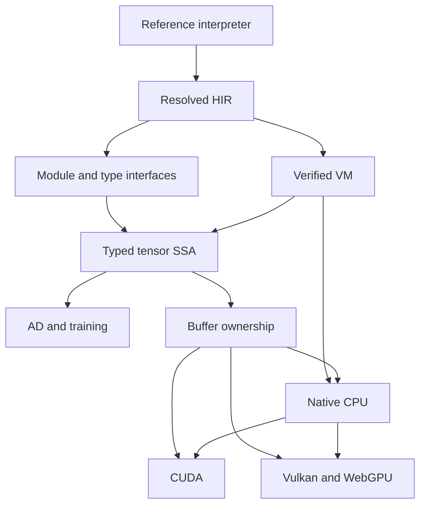

# Dependency graph and promotion gates

A node represents a testable artifact. Edges require the prerequisite artifact to pass its own acceptance check. Dependencies apply to a slice of a numbered expansion area. Requiring entire areas to finish would create cycles, including GPU memory versus device execution. The table is the authoritative graph; the diagram shows its compiler and numerical path.

| Gate | Artifact | Direct prerequisites | Earliest qualification window | Exit evidence |
|---|---|---|---|---|
| A | Foundation oracle | Existing audit | v0.1.0 | Recorded CLI cases, limits, seeded matrix oracle, locked source. |
| H | Resolved HIR | A | Phase 9 | Verify function IDs, local slots, original spans and canonical snapshots for the complete v0.1 subset. |
| V | Typed register VM | H | v0.2.0 | Verify instructions, compare all v0.1 outcomes, including traps, output and fuel, with AST. |
| L | Module and type interfaces | H | v0.2.0 | NFC module identity, cycle diagnostics and a bounded generic subset pass conformance. |
| T | Typed tensor SSA and effects | V, L | v0.3.0 | Verify dominance, guard ordering, types, device terms and pure/effect boundaries. |
| D | Differentiation and training slice | T | v0.3.0 | Gradients pass finite differences, adjoint tests and deterministic bilingual MLP replay. |
| M | Buffer ownership and lifetime model | T | v0.4.0 | Checked buffers, alias verifier and simulated completion/failure/reuse cases. |
| C | Native CPU reference lowering | M, V | v0.4.0 | Execute matched fixtures on x86-64 and AArch64 under declared numeric modes. |
| N | CUDA device adapter | M, C | v0.5.0 | On a named GPU verify transfer, matmul, synchronization, failure and cleanup. |
| W | Portable GPU adapters | M, C | v0.6.0 | Vulkan and WebGPU each pass declared positive/negative subsets on named devices. |
| E | Editor protocol and formatting | H, L | v0.7.0 | Negotiated offsets, rename, incremental revisions and formatter idempotence pass. |
| K | Package resolution and trust | L | v0.8.0 | Reproduce an offline lock, reject tampered content and rehearse a yank/revocation. |
| F | C-compatible foreign boundary | M, C | v0.9.0 | Cross-runtime buffers, failure translation and callback lifetime fixtures pass. |
| I | Model and AI library integration | D, K, F | v0.9.0 | Pinned model round trip, reproducible inference and simulated collective failure. |
| S | Stable supported profile | V, L, D, C, N, W, E, K, F, I | v1.0.0 | Publish ratified profiles, migration guarantees, signed artifacts and host/device evidence. |
| Q | Tasks, capabilities and failure isolation | S, M | v1.x | Cancellation, memory-order tests, bounded queues and denial fixtures pass on supported hosts. |
| X | Expanded target and ABI profiles | S, F | v1.x | Independent target runner verifies ABI, layout, linking and unsupported capabilities. |
| U | Distributed protocols | Q, K, I | v2.0.0 | Two-node recovery, duplicate handling and traceable collective replay pass. |
| B | Domain package qualification | K, F | v1.x onward | A real external consumer passes independently versioned integration and recovery fixtures. |
| O | Guarded optimization and tuning | T, C | v2.x onward | Verified candidate legality, guard fallback, held-out timing and numerical reports. |
| J | Cross-profile qualification | U, X, O, B | v3.0.0 | Independent runners reproduce the declared multi-profile release matrix and signed bundle. |
| Z | Independent bootstrap experiment | J | beyond v3.0.0 | Stage-0, stage-1 and stage-2 comparison with independent seed provenance and corpus replay. |

One valid topological order is A, H, V, L, T, E, K, D, M, C, N, W, F, O, I, B, S, Q, X, U, J, Z. A release may contain several independent gates. Research work can run earlier in isolation; shipping still requires its prerequisites. Gate A is verified. All later gates are proposed.

**Cycle resolution.** Prove completion leases using a simulated queue at M before adding the CUDA/Vulkan adapters. Rich distributed tensors depend on U, while gate I can validate protocol failure semantics with a simulator. A package consumer can qualify at B after K and F, without requiring the whole ecosystem or every host. Start with pure tensor SSA for D, then add a narrowly checked parameter-update boundary for training. General heterogeneous ownership follows at M. K can use local module identity without a public registry. Bootstrap Z can retain the external LLVM toolchain with provenance.

The [priority matrix](IMPLEMENTATION_PRIORITY_MATRIX.md) maps all 50 areas to these gate IDs. The [roadmap](MASTER_ROADMAP.md) provides the shipping sequence and profile rules.
