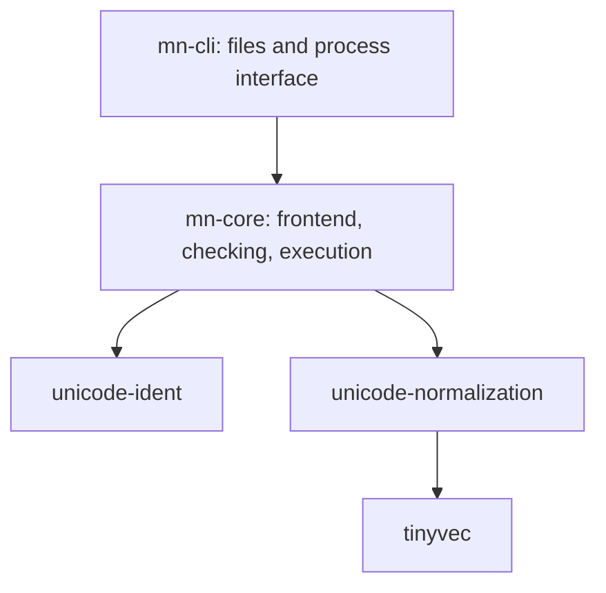

# Mongolia — Phase 1: Architecture baseline

Completed: 2026-11-18 (Asia/Ulaanbaatar). Revision: P1.1. Status: Phase 1 architecture deliverable complete; language stabilization and release approval remain separate gates.

## 1. Executive decision

Mongolia will evolve from a statically validated, bilingual reference interpreter into a compiler with shared typed tensor IR and multiple execution backends. English and Mongolian spellings are aliases in one language. All backends must derive their type, shape, effect and numerical rules from the same specification.

The immediate architecture uses two functional Rust crates: `mn-core` and `mn-cli`. Keep the existing implementation as the reference baseline. Extract additional crates only when working components have clear interfaces and independent tests. Native AI is the project direction; the foundation currently executes scalar and rank-2 tensor programs on the host CPU.

Priorities: correctness → safety → reproducibility → maintainability → performance → ecosystem growth. No throughput, speedup or production-readiness claim follows from this architecture.

This document fulfills Phase 1 of the original engineering protocol: technical blueprint, scope boundaries, architecture decisions and dependency graph. It does not implement Phase 2–7 work or replace the original source archive. Decisions marked **baseline** govern the foundation; decisions marked **proposed** require later implementation and verification. Neither label implies independent human review.

## 2. Evidence and starting point

Reviewed the current saved `mongolia-lang-v0.1.0-foundation.zip`, including its manifests, lockfile, ARCHITECTURE, SPEC, ADRs, STATUS, BUILD_REPORT, compiler source and recorded verification evidence.

Archive SHA-256: `6caee8f0cf1896684cc1b9a2adf510e87f2b7dbb7eb29ceadb148d4c63fa9980`.

| Evidence | Finding | Interpretation |
|---|---|---|
| Cargo.toml | Workspace contains mn-core and mn-cli | Actual implementation boundary |
| Cargo.lock | unicode-ident 1.0.22, unicode-normalization 0.1.24, transitive tinyvec 1.13.3 | Existing dependency baseline, not a recommendation to update |
| frontend.rs | Canonical aliases, NFC identifiers, source byte spans, AST | One bilingual frontend exists |
| engine.rs | Whole-program check, bounded AST interpreter, checked scalar/tensor operations | Reference execution exists |
| BUILD_REPORT and verification logs | Prior build/test/fmt/clippy pass; 35 tests recorded | Historical evidence for the archived snapshot; not re-executed in Phase 1 |
| SPEC versus engine.rs | SPEC claims tensor unary negation; checker only permits i64/f64 | Documentation defect P2-01; implementation behavior is recorded below |

The previous short status answer overstated completeness if interpreted as full compliance with every foundation requirement. The snapshot is a working candidate with known gaps. Architecture completion is distinct from a release passing all security, language and platform gates.

## 3. Scope contract

| Capability | Foundation baseline | Later work / promotion gate |
|---|---|---|
| Source and keywords | UTF-8; English/Mongolian aliases; mixed-language files | Vocabulary stabilization through RFC and native-speaker review |
| Identifiers | XID plus underscore; NFC; limited Latin/Cyrillic checks | Full versioned script/confusable policy and conformance corpus |
| Scalars | i64, f64, bool, string, unit | Other integer/float widths need conversion and numerical policies |
| Functions | Typed parameters, exact return types, named calls, immutable locals | Modules, generics, closures and control flow need new grammar and rules |
| Arithmetic | Exact operand types; checked i64; f64 arithmetic | Explicit casts and fast-math require separate specifications |
| Tensors | Nonempty rectangular rank-2 f64; literal static shapes | Symbolic/dynamic dimensions, views, broadcasting and higher ranks |
| Tensor operations | Matmul and equal-shape elementwise + − * / | Tensor unary minus is currently rejected; no silent semantic change |
| Validation | All function bodies checked before execution | Opaque checked-program handle and structured multi-label errors |
| Execution | Host AST interpreter; value copies; buffered output | Typed VM, native CPU and hardware backends |
| CLI | run, check, init, help, version; en/mn diagnostics | build/package/tooling commands only when implemented |
| Diagnostics | Byte spans; draft bilingual messages, some English fallback | Complete localization, display-width handling, LSP encodings |
| AD / GPU / FFI / packages / LSP | Architectural proposals only | Typed IR, ownership/effects and respective conformance gates |

Out of the Phase 1 execution scope: editing compiler behavior, inventing benchmark results, publishing a registry or GitHub release, provisioning hardware, or declaring stable language/ABI guarantees. Existing source semantics remain the input baseline.

## 4. Current implementation graph

Arrows mean “depends on”; they do not indicate execution order.

| Component | Owns | Public boundary | Must not own |
|---|---|---|---|
| frontend | Span, Error, tokens, Type, Program, Function, Expr, Stmt | parse(source) → Result<Program, Error>; lex for tooling/tests | Filesystem, process exit, device execution |
| engine checker | Function signatures, local environments, inferred types/shapes | check(program) → Result<(), Error> | Printing or executing user code during checking |
| engine runtime | Runtime values, tensor buffers, work budget, buffered output | run(program) → Result<String, Error>; internally checks program | CLI argument policy or package resolution |
| diagnostics | Draft language-dependent detail rendering | render_detail(error, lang) → String | Semantic interpretation of source |
| mn-cli | File loading, UTF-8 rejection, argument handling, source display, exit codes | mn commands | A second type system or backend-specific language semantics |

AST nodes own their child nodes and names. Spans refer to original source bytes; normalized names are separate strings. The caller retains source for rendering diagnostics. Function environments are invocation-local. Tensor reads currently copy buffers; this is an explicit cost and is not a borrow checker.

The present Rust API exposes mutable AST structures. `run` revalidates rather than trusting callers. A future `CheckedProgram` must bind the immutable program, resolved identities and type facts together; no mutation may invalidate its checks. This is an API migration proposal, not an existing type.

## 5. Target architecture and dependency direction

The target pipeline is source → canonical tokens → AST → resolved HIR → typed tensor IR → AD → SSA/MIR → optimizations → selected backend. The reference interpreter remains available as an oracle while new backends mature.

| Layer | Future crates | Allowed dependency direction |
|---|---|---|
| Shared data | mn-span, mn-ast, mn-hir, mn-shape, mn-ir | Data crates depend on lower-level data, never execution engines or CLI |
| Frontend | mn-diagnostics, mn-lexer, mn-parser, mn-resolve, mn-typeck | Consume shared data; parser depends on lexer/AST; resolver on AST/HIR; typeck on HIR/shape/IR |
| Transforms | mn-autodiff, mn-optimizer | Consume/produce verified IR; no CLI dependency |
| Execution | mn-runtime, mn-vm, mn-std, mn-ffi | Runtime has no frontend dependency; VM depends on IR/runtime; std/FFI use runtime contracts |
| Backend services | mn-codegen, mn-codegen-llvm, mn-codegen-cuda, mn-codegen-vulkan, mn-codegen-webgpu | codegen owns common interfaces; concrete backends depend on codegen/IR/runtime, never each other |
| Developer services | mn-package, mn-fmt, mn-lsp | Package resolver isolated from compiler internals; formatter consumes syntax; LSP consumes frontend queries |
| Composition | mn-cli | Selects services/backends and owns application wiring |

Important dependency correction: `mn-typeck` must depend on the crate owning its output representation when it begins producing typed IR. Keep `mn-ir` independent of `mn-typeck` to prevent a cycle. Shared builtin signatures must be data-only; the frontend must not depend on a device runtime merely to type-check a builtin. Extract a signature schema when the standard library makes this necessary.

Source mapping, type identity and device capability records need one owner each. Do not duplicate their definitions across backends. Backend-specific types stay behind adapters; no LLVM/MLIR handles may escape into AST or language-level diagnostics.

## 6. Architecture decision records

### ADR-P1-01 — One bilingual semantic path (baseline)

Context: two spellings must have equivalent observable behavior. Decision: normalize keyword aliases at lexing and identifiers to NFC before name resolution; keep original byte spans. Alternative: separate parsers/runtimes was rejected because it doubles conformance obligations. Consequence: alias tests compare canonical tokens and semantic results; user identifiers are not automatically translated. Revisit only through a syntax RFC with bilingual migration fixtures.

### ADR-P1-02 — Minimal functional workspace (baseline)

Context: the target lists many components but the foundation is small. Decision: two functional crates, internal modules for frontend/checker/runtime. Alternative: creating all target crates now adds interfaces without implementations. Consequence: coupling is tolerated within core temporarily; extraction requires a clear data owner, no dependency cycle and independent tests.

### ADR-P1-03 — Validated AST reference execution (baseline)

Context: correctness needs an executable oracle before backend investment. Decision: check all functions, then interpret the AST. Alternative: starting with LLVM/MLIR would make foundational errors harder to isolate. Consequence: execution is bounded and slower than a future optimized backend; AST execution is not the planned AD representation. Revisit after a typed IR and verifier exist.

### ADR-P1-04 — Exact numeric types and static rank-2 shapes (baseline)

Context: implicit promotions and broad tensor semantics multiply edge cases. Decision: i64/f64 exact-type arithmetic, checked i64 operations, rank-2 f64 tensor shapes. Reject incompatible known dimensions before runtime. Alternative: dynamic typing or implicit widening is deferred. Consequence: integer tensor cells and f32 annotations remain unsupported; new precisions need explicit rounding/accumulation rules. Tensor unary negation stays rejected until an explicit semantic change is approved through the repository workflow.

### ADR-P1-05 — Safe Rust and explicit resource policy (baseline)

Context: malicious source can exhaust memory, stack or work without unsafe code. Decision: safe Rust, checked size arithmetic, input/depth/fuel/output limits and Result errors. Alternative: treating memory safety as complete isolation is invalid. Consequence: this is not a security sandbox; process OOM remains possible outside fallible allocation paths. Limits are documented implementation policy, not hidden language behavior.

### ADR-P1-06 — Shared typed IR before AD and backend expansion (proposed)

Context: differentiating surface syntax loses resolved type/effect/shape information. Decision: resolved HIR followed by typed tensor IR with explicit effects and guards; AD precedes destructive bufferization. Alternatives: runtime-only tracing or backend-specific AD are not the default compiler architecture. Consequence: more middle-end work precedes neural-network training; custom derivative rules must satisfy IR contracts.

### ADR-P1-07 — Typed register VM (proposed)

Context: need faster iterative execution and direct lowering from SSA. Decision: prototype a typed register VM with explicit call frames, shape guards and source maps. Alternative: a stack VM may offer simpler encoding. Consequence: register allocation and instruction verification become required; keep bytecode private/versioned. Freeze the choice only after dispatch, code-size and startup measurements on equivalent workloads.

### ADR-P1-08 — Isolated native/hardware backends (proposed)

Context: CPU, CUDA, Vulkan and WebGPU have different capabilities. Decision: shared backend contract, explicit target selection and separate lowering adapters. CPU uses the planned MLIR/LLVM route; CUDA targets GPU/NVVM lowering; portable paths target SPIR-V or WGSL. Consequence: no universal GPU feature promise and no silent device fallback. Exact upstream versions/APIs must be verified when integration begins.

### ADR-P1-09 — Ownership tied to asynchronous completion (proposed)

Context: lexical scope can end before queued device work completes. Decision: combine language ownership/borrows with runtime completion leases retaining device buffers until commands finish. Alternatives: host lexical lifetimes alone are insufficient; global synchronization is correct but costly. Consequence: cancellation, device loss and allocator reuse must honor outstanding operations. Runtime lifetime tests are a release prerequisite.

### ADR-P1-10 — Reproducibility and private compiler ABI (baseline/proposed)

Context: reproducible dependencies and long-lived language interoperability are different problems. Decision: pin the foundation toolchain/lockfile; keep Rust AST/IR/bytecode ABI private. Future C interoperability uses explicit compatible layouts and ownership, with no unwinding across incompatible boundaries. Consequence: Rust native ABI is not an interoperability promise; offline builds need cached or vendored verified dependencies.

### ADR-P1-11 — Explicit effects and strict numerical defaults (proposed)

Context: optimizations and AD can reorder observable actions or change arithmetic. Decision: model IO, allocation, mutation, transfer, synchronization and failure; preserve strict operation order by default. Alternative: unconditional fast-math/reassociation is rejected. Consequence: transforms must preserve effect/trap dependencies. Future relaxed numerical modes require explicit contracts and separate conformance tolerances; exact float bit equality across every backend is not promised.

### ADR-P1-12 — Evidence gates and staged stability (baseline)

Context: a designed feature can be mistaken for implemented software. Decision: every capability is implemented, experimental, planned or research-stage with evidence. Examples claiming support must execute. Consequence: Phase 1 closes on design artifacts; public release requires wider checks. No benchmark claim without workload, precision, hardware, methodology and raw results.

## 7. IR and pass contracts

| Representation | Required invariant | Verification gate |
|---|---|---|
| Tokens/AST | Valid original-source byte spans; canonical keywords; syntactic structure | Unicode and parser corpus; nesting limits |
| HIR (future) | Stable symbol IDs; explicit scopes; no unresolved ordinary names | Resolve every use; detect duplicate/cyclic module definitions |
| Typed Tensor IR (future) | Every result has type, rank, shape constraints, device and effects | Check operand/result signatures; guards dominate dependent operations |
| SSA/MIR (future) | Single definition, dominating uses, valid CFG and block arguments | SSA/dominance/terminator verifier |
| Buffer/device IR (future) | Layout and checked size; alias/ownership facts; completion dependencies | Bounds, alias and asynchronous lifetime verifier |
| Backend artifact (future) | Declared target capabilities and math mode | Target legality checks plus reference conformance |

Pass order: verify → shape/effect analysis → AD when requested → verify → conservative folding/DCE/CSE → bounded inlining → specialization → fusion → bufferization → memory planning → tiling/vectorization → target lowering → verify. This is a proposed default, not a rigid requirement that every program runs every pass.

Every pass declares preconditions, changed IR fields and preserved analyses. Unless preservation is proven, invalidate affected shape, alias, liveness and dominance facts. Never remove an observable error or side effect as dead code. AD rejects unsupported effects and foreign operations without derivative rules. A guard has a source origin and executes before the allocation/kernel it protects.

## 8. Runtime, security and failure boundaries

Current policy: at most 1 MiB source, 100,000 tokens, bounded parser expressions, 1,000,000 tensor elements, 1,000,000 runtime work units, bounded evaluation depth and 1,000,000 output bytes. These are not equivalent to a total resident-memory cap. Tensor lookup copies and compiler allocations can amplify memory use.

Static errors prevent execution. Runtime failure returns a diagnostic and discards buffered output in the current interpreter. Future interactive IO must explicitly revise this output contract through specification work; it cannot silently inherit transactional behavior that external IO cannot guarantee.

Future allocators report recoverable allocation failures where supported; ownership does not eliminate OOM. Unsafe code is confined to audited FFI/driver adapters, with safe invariants documented at every boundary. Native callbacks and exceptions must not unwind through incompatible ABIs. Packages must not execute arbitrary installation scripts by default. Untrusted compilation/execution requires external process isolation as well as language limits.

## 9. Risk register and unresolved choices

| ID | Risk or open issue | Default / mitigation | Owner role and gate |
|---|---|---|---|
| P2-01 | SPEC claims tensor unary minus while checker rejects it | Correct SPEC to scalar-only in Phase 2; new support requires implementation/tests | Language maintainer; spec/source alignment |
| P2-02 | Partial Unicode script/confusable coverage | Specify exact current coverage; choose versioned complete policy | Language/security; before stable vocabulary |
| P2-03 | Incomplete Mongolian localization | Enumerate fallback messages; native-speaker terminology review | Diagnostics/native reviewer; before localization claim |
| P2-04 | Public mutable AST may invalidate cached checks | Opaque checked artifact before persistent typed facts | Frontend; before incremental compilation |
| P2-05 | Spec resource limits versus actual counter semantics | Document exact units and boundaries with negative tests | Runtime; before release gate |
| P2-06 | Numerical backend differences | Strict defaults, explicit accuracy classes and reproducible comparisons | Numerical/backend; before backend promotion |
| P2-07 | Modules/generics expand inference complexity | Resolved HIR and explicit constraints first | Type system; v0.2 gate |
| P2-08 | AD aliasing and control-flow derivatives | Effects/ownership contracts plus finite differences and adjoint tests | AD; v0.3 gate |
| P2-09 | Async device use-after-free or stale buffer reuse | Completion leases and failure injection | Runtime/GPU; device release gate |
| P2-10 | Registry/name/provenance availability unknown | Verify before publication; no ownership availability claim now | Governance/security; public release gate |
| P2-11 | Toolchain/backend dependency churn | Version adapters and upgrade conformance | Toolchain; integration gate |

No unresolved choice blocks the Phase 1 design. These are queued implementation/specification gates, not implicit permission to weaken semantics.

## 10. Phase 2 handoff and measurable acceptance

Phase 2 must finalize the normative v0.1 grammar and semantic rules against the actual source. Its immediate work items are P2-01, exact lexical/security coverage, numeric edge behavior, return/call rules, tensor copy and allocation rules, error spans/localization, and a complete requirement-to-test matrix. Preserve the prototype; treat any changed behavior as an explicit change with negative tests.

Acceptance A/B: equivalent English/Mongolian matmul yields [[19.0, 22.0], [43.0, 50.0]]. C: mixed syntax yields 30. D: incompatible inner dimensions 3 and 2 fail before output and report both shapes. E: typed add call yields 42. Also map malformed UTF-8, invalid syntax, delimiter omissions, argument arity, undefined/duplicate names, ragged tensors, annotations, precedence, zero division, overflow, source spans and CLI exits to executable cases.

Future milestone dependency gates: HIR/modules precede generic VM expansion; typed IR/effect analysis precede AD; verified SSA and memory planning precede native CPU; asynchronous ownership precedes GPU; registry governance precedes public packages. LSP work may proceed when frontend query identities and invalidation semantics are stable. The roadmap versions are milestone proposals, not delivery dates.

## 11. Phase report and exit criteria

| Required report item | Result |
|---|---|
| Objective | Establish the engineering architecture and next-phase contract |
| File created | MONGOLIA_PHASE_1_ARCHITECTURE.md |
| Existing files modified | None; source archive retained as the evidence baseline |
| Technical decisions | ADR-P1-01 through ADR-P1-12, with alternatives and consequences |
| Implementation status | Existing two-crate candidate inspected; no compiler implementation added in this phase |
| Verification | Archive SHA-256 matched; lockfile dependency graph passed a cycle check; source/API and specification compared; scalar-only negation confirmed; 12 ADRs, 11 report sections and balanced code fences checked |
| Known limitations | Full Unicode policy, localization, cross-platform evidence, future IR/backends and public release review remain open |
| Remaining work | Phase 2 specification reconciliation and acceptance matrix |
| Exit criterion: blueprint and scope | Satisfied by sections 1–3 |
| Exit criterion: dependency graph and owners | Satisfied by sections 4–5; current graph acyclic |
| Exit criterion: decisions with consequences | Satisfied by section 6 |
| Exit criterion: invariants and failure model | Satisfied by sections 7–8 |
| Exit criterion: risks and next-phase gates | Satisfied by sections 9–10 |

Phase 1 is complete as an architecture baseline. This does not certify all original prompt requirements as implemented, nor imply that a human design review or stable release has occurred.
